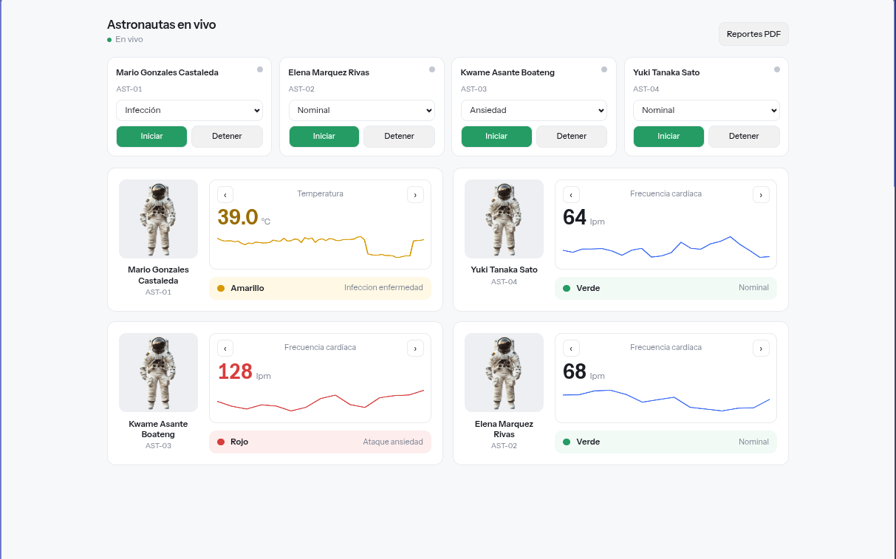
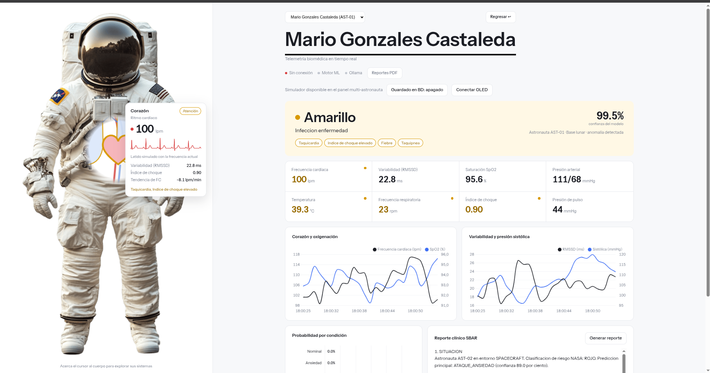
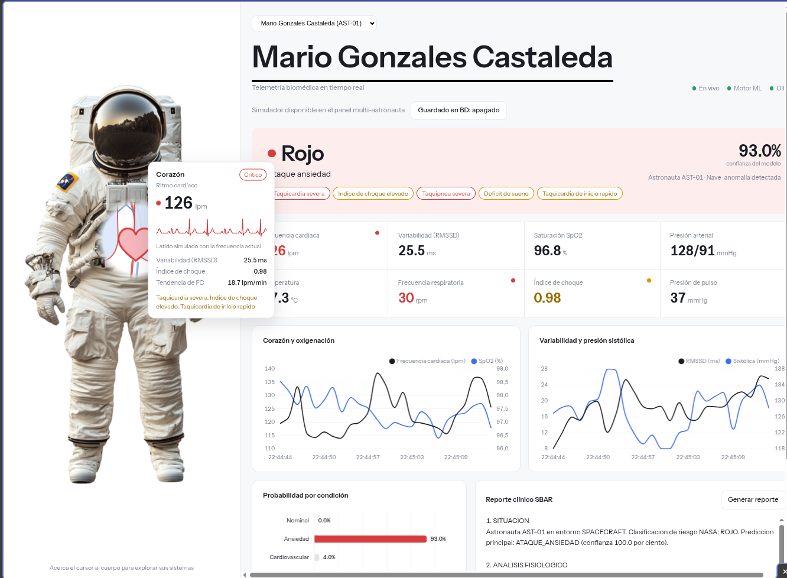
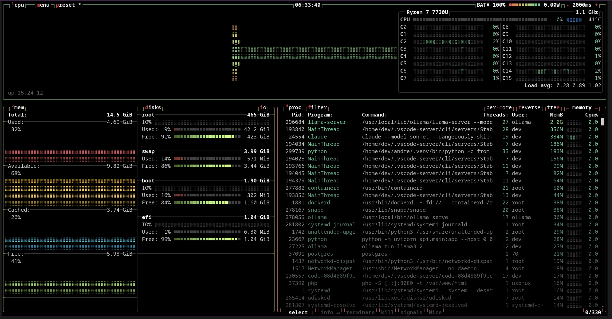
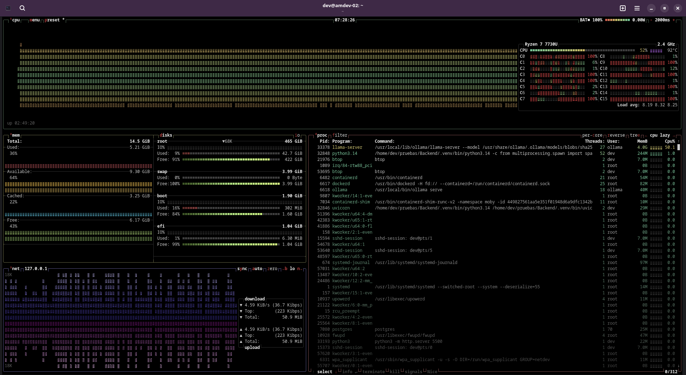

# Project LynxLab

**NASA Space Apps Challenge | Create Health Monitoring Software for Astronauts on Space Missions**

<p align="center">
	<a href="imagenesx/1.png"></a><br>
	<a href="imagenesx/2.png"></a><br>
	<a href="imagenesx/3.png"></a>
</p>

LynxLab es un prototipo local de monitoreo biomédico para misiones espaciales. Recibe o simula signos vitales, evalúa posibles anomalías y presenta el estado de cada astronauta en dashboards para la tripulación y el control de misión. Ante hallazgos, puede generar un reporte clínico en formato SBAR.

**Demostraciones:** [Ver presentación](https://canva.link/l6er9uk3bv85cpy) **Demo web:** [Demo web estática](https://amdevs.mx/nasa-space-app-challenge/lynxlab) · **Repositorio:** [IndieSeal/Hackathon-NASA-SpaceApps](https://github.com/IndieSeal/Hackathon-NASA-SpaceApps)

## Qué incluye

- Panel en vivo para varios astronautas y dashboard individual con gráficas de signos vitales.
- Simulador con escenarios nominales y de riesgo para demostrar alertas sin sensores físicos.
- Motor Python que calcula métricas derivadas, detecta anomalías y clasifica el riesgo con los niveles `VERDE`, `AMARILLO` y `ROJO`.
- Reportes SBAR redactados en español por `llama3.2` mediante Ollama local; si Ollama no está disponible, se usa un reporte de respaldo determinista.
- Persistencia opcional de lecturas en PostgreSQL.

El modelo de lenguaje solo redacta el informe a partir del diagnóstico calculado por el motor; no decide la clasificación ni inventa valores biomédicos.

## Stack

| Área | Tecnología |
|---|---|
| API y tiempo real | Python 3.11+, FastAPI, REST y WebSockets |
| Análisis biomédico | NumPy, scikit-learn y reglas deterministas en Python |
| Reportes asistidos por LLM | Ollama local, `llama3.2` (opcional) |
| Dashboard | HTML, CSS, JavaScript y Chart.js |
| Persistencia | PostgreSQL 16 y asyncpg (opcional) |

## Iniciar el prototipo

Requisitos para el recorrido básico: Python 3.11+ y un navegador. No se requieren Ollama ni Docker para probar el dashboard con telemetría simulada.

1. En una terminal, instala dependencias e inicia la API:

	```bash
	cd Backend
	python3 -m venv .venv
	source .venv/bin/activate
	pip install -r requirements.txt
	uvicorn api.main:app --reload --host 0.0.0.0 --port 8000
	```

	En Windows PowerShell, activa el entorno con `.venv\Scripts\Activate.ps1` en lugar de `source .venv/bin/activate`.

2. En otra terminal, sirve el frontend:

	```bash
	cd Frontend
	python3 -m http.server 5500
	```

3. Abre el [dashboard multi-astronauta](http://localhost:5500/multi.html?api=http://localhost:8000). Selecciona un escenario y pulsa **Iniciar** para ver la telemetría simulada. El [dashboard individual](http://localhost:5500/index.html?api=http://localhost:8000) y la [documentación interactiva de la API](http://localhost:8000/docs) también están disponibles.

## Servicios opcionales

**Reportes con Ollama:** instala Ollama, inicia el servicio y descarga el modelo configurado:

```bash
ollama serve
ollama pull llama3.2
```

Al estar disponible, la API lo utiliza para redactar los reportes SBAR. Sin Ollama, la demo sigue funcionando con el generador de respaldo.

**Guardar telemetría en PostgreSQL:** con Docker Compose instalado, desde `Backend/` ejecuta:

```bash
docker compose up -d
```

Esto inicia PostgreSQL y Adminer. Después, activa **Guardado en BD** desde el dashboard. Adminer queda disponible en [http://localhost:8080](http://localhost:8080).

## Consumo de recursos

En las pruebas locales, el servidor completo consume aproximadamente **900 MB de RAM en reposo sin el modelo de Ollama cargado** y hasta **2 GB con `llama3.2` cargado**. Ollama se ejecuta en CPU y, mientras está inactivo, el uso de CPU puede permanecer en **0%**. Durante simulaciones y carga extrema se observó un máximo aproximado de **10 GB de RAM** y **51% de CPU** al estar conectadas 4 personas mediante ssh pero sin conexiones y 4 simulaciones llega a 3 - 4 GB de ram en produccion de simulacion...

Son cifras de referencia observadas en el equipo de prueba; pueden variar según el hardware, el sistema operativo, el modelo cargado y la cantidad de simulaciones simultáneas.

<p align="center">
	<strong>Servidor en reposo</strong><br>
	<a href="imagenesx/reposo.png"></a><br>
	<strong>Servidor durante simulaciones y carga alta</strong><br>
	<a href="imagenesx/enuso.png"></a>
</p>

## Referencias NASA

- [Risk of Cardiovascular Adaptations](https://www.nasa.gov/reference/risk-of-cardiovascular-adaptations/)
- [Risk of Hypoxia](https://www.nasa.gov/reference/risk-of-hypoxia/)

Este proyecto es un prototipo de hackathon con telemetría simulada; no es un dispositivo médico ni sustituye la evaluación de profesionales de salud, por ahora.....

## Equipo

| Integrante | País | Contribución |
|---|---|---|
| Alejandro Sacbe Martinez Ibarra | México | Desarrollo frontend |
| Andre Mateo Vasquez Mosqueda | México | Desarrollo backend |
| Ethan Miguel Mahlstedt Aviles | México |Demo con Arduino y configuración del display  |
| Jubet Amdeleli Novelo Ibarra | México | Demo con Arduino y configuración del display |
| José Pablo Luque Ayala | México | Demo con Arduino y configuración del display |
| Dania Paez Garate | México | Diseño de la presentación y apoyo general |


67
